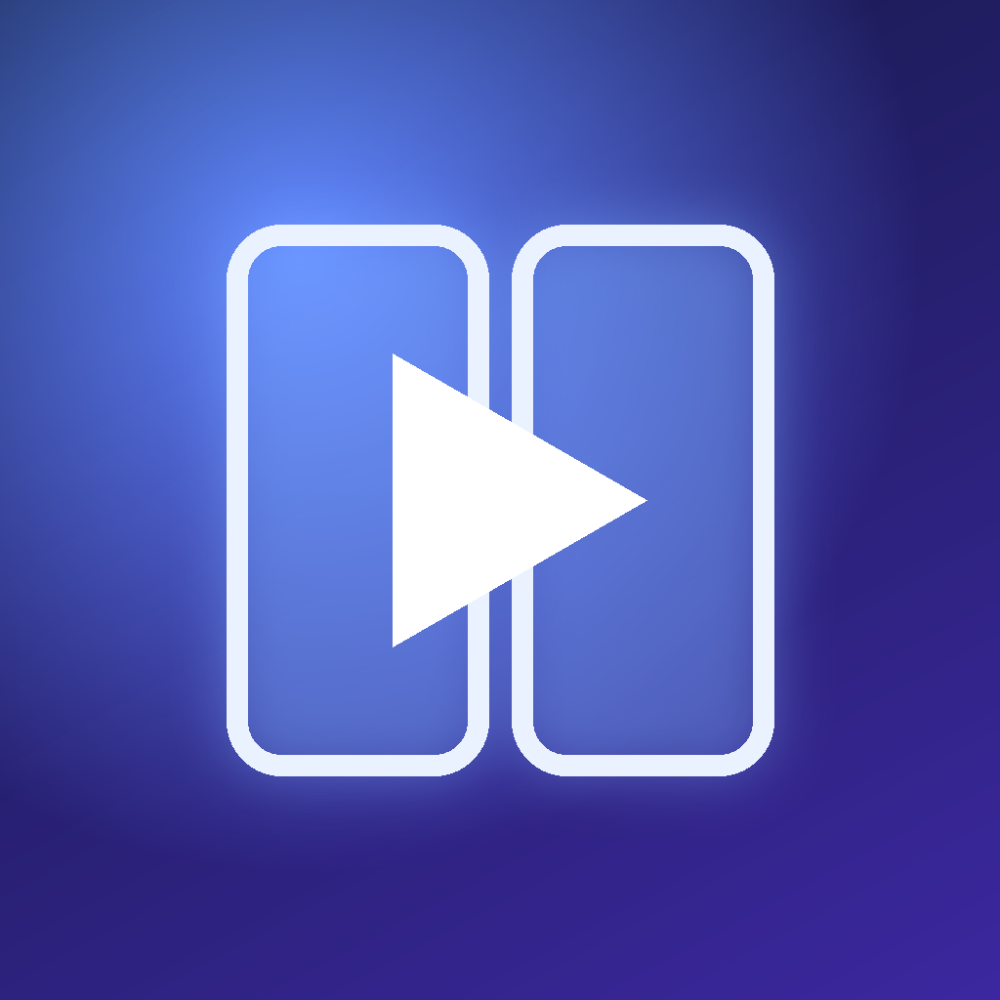

<p align="center"></p>

<h1 align="center">Shiro</h1>
<p align="center"><b>PS4 · PS5 · PS5 Pro Remote Play for iPhone — designed for iPhone Duo</b></p>

---

## Install (AltStore / SideStore / Feather / ESign)

Add this source to your IPA installer:

```
https://github.com/westernpluto/Shiro/releases/download/altsource/apps.json
```

- **AltStore / SideStore:** Browse › Sources › **+** › paste the URL.
- **Feather / ESign / Scarlet:** Sources › Add › paste the URL.
- Or download the newest `Shiro-vX.Y.Z.ipa` from [Releases](https://github.com/westernpluto/Shiro/releases) and sideload it.

Every push to `main` builds a new, versioned release (`1.0.<build>`) and updates the source automatically, so your installer offers updates as they land. You can also trigger a build manually from **Actions › Build & Release › Run workflow**.

## Features

| | |
|---|---|
| **Consoles** | PS4, PS4 Pro, PS5, PS5 Digital, PS5 Pro |
| **Video** | Up to 1080p60 (the Remote Play maximum on every console, including PS5 Pro), H.264 / HEVC / **HEVC HDR** (Main10, PQ), up to 50 Mbps |
| **Latency** | Hardware decoding through `AVSampleBufferDisplayLayer`; frames are shown the moment they're decoded, with ProMotion refresh enabled |
| **A/V sync** | Fixed-size jitter buffer for audio (adjustable from 20 ms). If audio falls behind the picture, the late part is dropped so the two stay in sync |
| **Internet play** | Remote Play over PSN with UDP hole punching, so no port forwarding is needed. UPnP is used when the router supports it |
| **Registration** | **Automatic, without a PIN**, via your PSN account, or with the classic 8-digit PIN |
| **Wake** | Wakes consoles from rest mode |
| **Controllers** | DualSense / Edge, DualShock 4, Xbox, MFi, Switch Pro. Supports multiple controllers at once (see couch co-op below) |
| **DualSense** | Adaptive triggers, haptics (converted to rumble), light bar, touchpad, motion / gyro |
| **Touch** | On-screen controller and a multi-touch touchpad. The phone can also be used as a full-screen touchpad while video plays on a TV |
| **External display** | USB-C / HDMI / AirPlay. Video moves to the TV (in HDR if the TV supports it) and the iPhone becomes a companion touchpad with system buttons |
| **Microphone** | Voice chat to the console |
| **Keyboard** | The console's on-screen keyboard is mirrored on the iPhone |

### Designed for iPhone Duo

Built against the iOS 27.1 SDK following Apple's *Designing for iPhone Duo* guidance:

- **Every pose is playable.** The game fills the outer display, the flat inner display, and the book and laptop poses without moving controls around.
- **Fold-aware split.** When the device is partially folded, Shiro reads the hinge (`ReservedRegion` `.division`). The system `ArrangementView` then puts the game on one half and a touchpad and control deck on the other.
- **Letterbox artwork.** On the near-square inner display, the bars around a 16:9 stream are filled with a blurred ambient extension of the picture instead of black.
- **Adaptive navigation.** `NavigationSplitView` collapses to one column on the compact outer display and becomes sidebar + content on the inner display. Toolbars use `Label` items in `ToolbarItemGroup`s, so the system can place them vertically. The console grid always uses an even number of columns.
- **Reserved regions respected.** Interactive overlays stay inside safe areas, away from the camera housings and the fold.

### Couch co-op

Any number of controllers can be connected to the iPhone at once. The chiaki-ng protocol layer Shiro currently uses sends **one** controller's input to the console, so for now there are three modes:

- **Shared:** every controller drives the game at the same time. Good for helping someone through a section, or for games with shared control.
- **Hand-off:** whoever pressed a button last has control, with no re-pairing.
- **Player 1 only.**

PS5 Remote Play itself can carry several players (other clients offer 4-player couch co-op). Real multi-player input is planned for Shiro's own protocol implementation. Until then, for split-screen multiplayer, connect the extra controllers directly to the console; they play alongside the streamed player.

## First run

1. On the console, enable Remote Play: **PS5:** Settings › System › Remote Play. **PS4:** Settings › Remote Play Connection Settings.
2. For waking and internet play, enable **Stay connected to the Internet** and **Enable turning on from network** in the console's Rest Mode settings.
3. In Shiro, open **Settings › Sign in to PlayStation Network**.
4. Tap your console, then **Register automatically**. If you prefer, choose **Register with PIN** and enter the code shown under *Link Device*.
5. Tap the console to play. Long-press it for **Play over the internet**, **Wake**, **Edit** or **Forget**.

For HDR on a PS5, turn on HDR on the console (Settings › Screen and Video › Video Output › HDR). Leave the codec on *Automatic*.

## Building it yourself

CI does this for you, but the steps are:

```bash
brew install xcodegen ninja pkgconf protobuf@29 ldid
python3 -m pip install --user 'protobuf>=5,<6'
PROTOC_BIN=$(brew --prefix protobuf@29)/bin/protoc ./scripts/build-chiaki-ios.sh   # chiaki-ng + deps for iOS
xcodegen generate
open Shiro.xcodeproj    # requires Xcode 27.1+ (iPhone Duo SDK)
```

`scripts/build-chiaki-ios.sh` cross-compiles [chiaki-ng](https://github.com/chiaki-ng/chiaki-ng) and its dependencies (OpenSSL, Opus, libevent, curl, json-c, miniupnpc, nanopb, jerasure) for arm64 iOS. It merges them into `Vendor/Chiaki/lib/libchiaki-ios.a`.

### Project layout

```
Shiro/
  App/            entry point, external-display scene, app model
  Bridge/         C helpers (Annex-B → AVCC, chiaki struct glue) + bridging header
  Core/
    Chiaki/       logging, helpers
    Discovery/    LAN discovery (unicast sweep + broadcast) and wake-up
    Registration/ PIN registration
    PSN/          PlayStation Network OAuth
    Stream/       session, video renderer, audio renderer, microphone
    Input/        controllers, co-op, haptics, adaptive triggers
    Display/      external display + HDR
    Store/        consoles, settings, keychain
  UI/             SwiftUI screens (home, stream, iPhone Duo layout, settings)
scripts/          dependency build, IPA packaging, AltStore source generator
```

## TestFlight

**Internal testing is ready.** `.github/workflows/testflight.yml` signs, archives and uploads an internal-only TestFlight build. See [docs/TESTFLIGHT.md](docs/TESTFLIGHT.md) for the one-time setup: certificate, profile, API key and repository secrets.

**External TestFlight and the App Store are not ready.** Shiro links chiaki-ng, which is **AGPL-3.0**, so Shiro is AGPL-3.0 too (see `LICENSE`). Public distribution through Apple adds usage terms that are widely considered incompatible with the GPL family. A licence-clean protocol implementation is planned before any public release.

## License

[AGPL-3.0](LICENSE), with the OpenSSL linking exception, inherited from chiaki-ng.

Shiro is not affiliated with or endorsed by Sony Interactive Entertainment. "PlayStation", "PS4", "PS5" and "DualSense" are trademarks of Sony Interactive Entertainment Inc.
